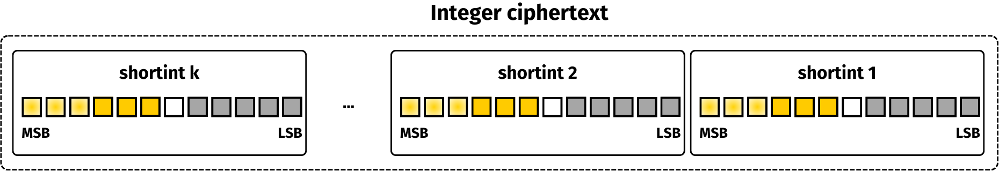

# Operations

The structure and operations related to integers are described in this section.

## How an integer is represented

In `integer`, the encrypted data is split amongst many ciphertexts encrypted with the `shortint` library. Below is a scheme representing an integer composed by k shortint ciphertexts.



### Radix-based integers.

Large integers are represented using a Radix-based decomposition on the plaintexts. Let $$B \in \mathbb{N}$$ be a basis such that the size of $$B$$ is smaller than (or equal to) 4 bits. Then, an integer $$m \in \mathbb{N}$$ can be written as $$m = m_0 + m_1*B + m_2*B^2 + ...$$, where each $$m_i$$ is strictly smaller than $$B$$. Each $$m_i$$ is then independently encrypted. In the end, an Integer ciphertext is defined as a set of shortint ciphertexts.

The definition of an integer requires a basis and a number of blocks. These parameters are chosen at key generation. Below, the keys are dedicated to integers encrypting messages over 8 bits, using a basis over 2 bits (i.e., $$B=2^2$$) and 4 blocks.

```rust
use tfhe::integer::gen_keys_radix;
use tfhe::shortint::parameters::PARAM_MESSAGE_2_CARRY_2_KS_PBS;

fn main() {
    // We generate a set of client/server keys, using the default parameters:
    let num_block = 4;
    let (client_key, server_key) = gen_keys_radix(PARAM_MESSAGE_2_CARRY_2_KS_PBS, num_block);
}
```

In this representation, the correctness of operations requires the carries to be propagated throughout the ciphertext. This operation is costly, since it relies on the computation of many programmable bootstrapping operations over shortints.

## List of available operations

The list of operations available in `integer` is:

* Negation
* Addition
* Scalar Addition
* Subtraction
* Scalar Subtraction
* Multiplication
* Scalar Multiplication
* Bitwise OR, AND, XOR
* Equality
* Left/Right Shift
* Comparisons `<`,`<=`,`>`, `>=`
* Min, Max

## Types of operations

Much like `shortint`, the operations available via a `ServerKey` may come in different variants:

* operations that take their inputs as encrypted values.
* scalar operations take at least one non-encrypted value as input.

For example, the addition has both variants:

* `ServerKey::unchecked_add`, which takes two encrypted values and adds them.
* `ServerKey::unchecked_scalar_add`, which takes an encrypted value and a clear value (the so-called scalar) and adds them.

Each operation may come in different 'flavors':

* `unchecked`: always does the operation, without checking if the result may exceed the capacity of the plaintext space.
* `default`: always compute the operation and always clear the carry. This ensures that the result is correct and that the timings are consistent from one call to another.

Not all operations have these 2 flavors, as some of them are implemented in a way that the operation is always possible without ever exceeding the plaintext space capacity.


If you don't know which flavor to use, you should use the `default` one.


## How to use each operation type

Let's try to do a circuit evaluation using the different flavors of already introduced operations. For a very small circuit, the `unchecked` flavor may be enough to do the computation correctly. Otherwise, the `default` flavor should be used.

As an example, let's do a scalar multiplication, a subtraction, and an addition.

```rust
use tfhe::integer::gen_keys_radix;
use tfhe::shortint::parameters::PARAM_MESSAGE_2_CARRY_2_KS_PBS;

fn main() {
    let num_block = 4;
    let (client_key, server_key) = gen_keys_radix(PARAM_MESSAGE_2_CARRY_2_KS_PBS, num_block);

    let msg1 = 12u64;
    let msg2 = 11u64;
    let msg3 = 9u64;
    let scalar = 3u64;

    // message_modulus^vec_length
    let modulus = client_key.parameters().message_modulus().0.pow(num_block as u32);

    // We use the client key to encrypt two messages:
    let mut ct_1 = client_key.encrypt(msg1);
    let ct_2 = client_key.encrypt(msg2);
    let ct_3 = client_key.encrypt(msg2);

    server_key.unchecked_small_scalar_mul_assign(&mut ct_1, scalar);

    server_key.unchecked_sub_assign(&mut ct_1, &ct_2);

    server_key.unchecked_add_assign(&mut ct_1, &ct_3);

    // We use the client key to decrypt the output of the circuit:
    let output: u64 = client_key.decrypt(&ct_1);
    // The carry buffer has been overflowed, the result is not correct
    assert_ne!(output, ((msg1 * scalar - msg2) + msg3) % modulus);
}
```

During this computation the carry buffer has been overflowed, and the output may be incorrect as all the operations were `unchecked`.

The main advantage of the default flavor is to ensure predictable timings, as long as only this kind of operation is used. Only the parallelized version of the operations is provided.


Using `default` could **slow down** computations.


```rust
use tfhe::integer::gen_keys_radix;
use tfhe::shortint::parameters::PARAM_MESSAGE_2_CARRY_2_KS_PBS;

fn main() {
    let num_block = 4;
    let (client_key, server_key) = gen_keys_radix(PARAM_MESSAGE_2_CARRY_2_KS_PBS, num_block);

    let msg1 = 12u64;
    let msg2 = 11u64;
    let msg3 = 9u64;
    let scalar = 3u64;

    // message_modulus^vec_length
    let modulus = client_key.parameters().message_modulus().0.pow(num_block as u32);

    // We use the client key to encrypt two messages:
    let mut ct_1 = client_key.encrypt(msg1);
    let ct_2 = client_key.encrypt(msg2);
    let ct_3 = client_key.encrypt(msg3);

    server_key.scalar_mul_assign_parallelized(&mut ct_1, scalar);

    server_key.sub_assign_parallelized(&mut ct_1, &ct_2);

    server_key.add_assign_parallelized(&mut ct_1, &ct_3);

    // We use the client key to decrypt the output of the circuit:
    let output: u64 = client_key.decrypt(&ct_1);
    assert_eq!(output, ((msg1 * scalar - msg2) + msg3) % modulus);
}
```
